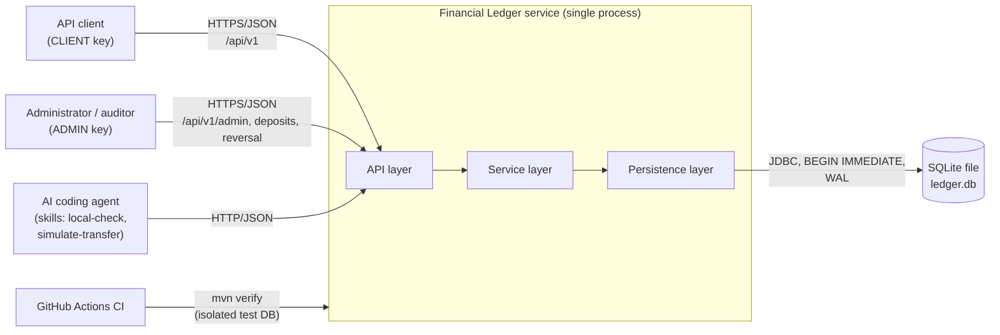
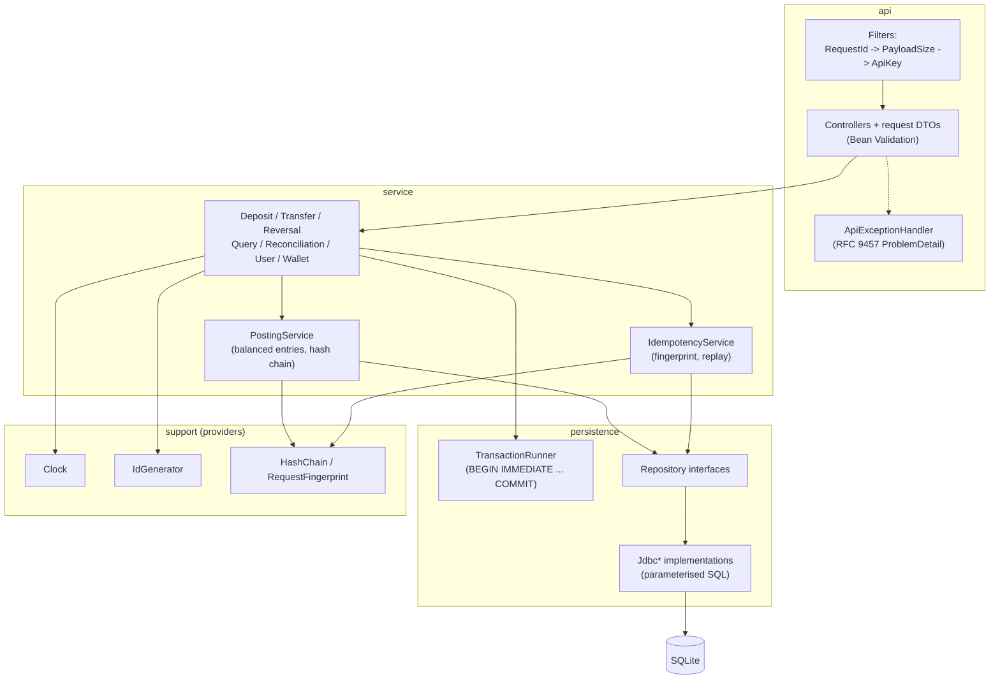
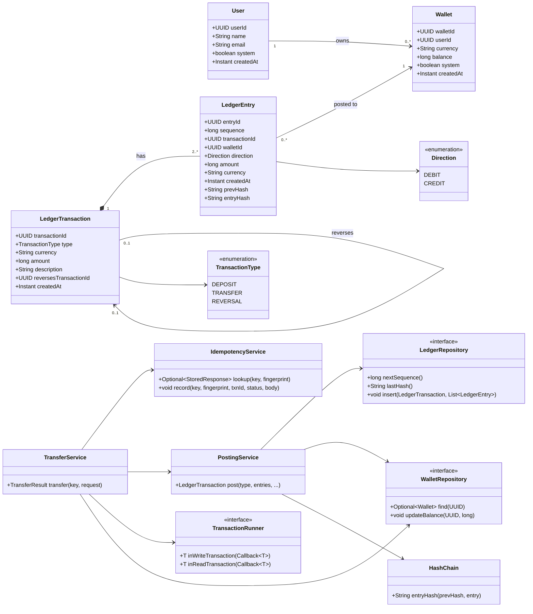
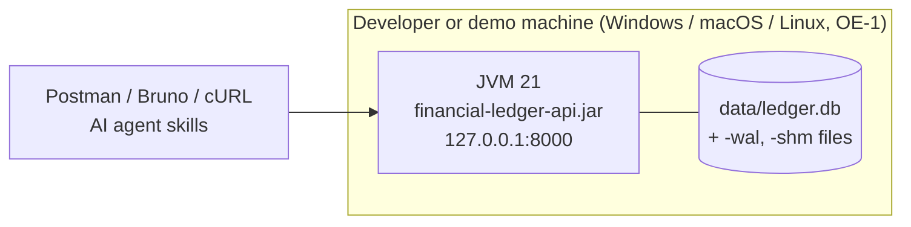

# Architecture

Stage 2 design of the Financial Ledger & Digital Wallet API (SRS SE-2). It refines the SRS analysis models (Figures 1-4) into the structure we build in Stage 3. Decisions behind it: [ADR-0001](../adr/0001-implementation-stack.md) (stack), [ADR-0002](../adr/0002-transactions-concurrency-idempotency.md) (transactions), [ADR-0003](../adr/0003-ledger-integrity-hash-chain.md) (ledger integrity), [ADR-0004](../adr/0004-http-error-model.md) (errors). Data model: [data-model.md](data-model.md). Behaviour: [behaviour.md](behaviour.md). Error catalogue: [error-codes.md](error-codes.md).

## 1. System context

One Spring Boot process owns one SQLite database file on the local disk (AS-1, OE-3, CON-1). Clients call it over HTTP/JSON; AI agents operate it through Agent Skills; CI builds and tests it with an isolated database.

## 2. Layers and packages (CON-5)

Code lives under `edu.iiitb.team007.ledger`. Dependencies point one way only - `api` -> `service` -> `persistence` - and every layer may use `domain` and `support`. Nothing in `service` or `domain` imports Spring Web, servlet or JDBC types.

| Package | Responsibility | Main classes (Stage 3) | Requirements |
|---|---|---|---|
| `api` | HTTP: routing, request DTOs and validation, filters, problem details | `HealthController`, `UserController`, `WalletController`, `TransferController`, `TransactionController`, `AdminController`, `ApiExceptionHandler`, `RequestIdFilter`, `PayloadSizeFilter`, `ApiKeyFilter` | FR-0, FR-6.4, CI-3, CI-4, UI-3 |
| `service` | Business rules and units of work | `UserService`, `WalletService`, `DepositService`, `TransferService`, `ReversalService`, `QueryService`, `ReconciliationService`, `IdempotencyService`, `PostingService` | FR-1-FR-6, BR-1-BR-9 |
| `domain` | Immutable value types | `User`, `Wallet`, `LedgerTransaction`, `LedgerEntry`, `Direction`, `TransactionType`, `ErrorCode`, `ApiException`, `ReconciliationReport` | DR-1, CON-3 |
| `persistence` | SQL via `JdbcTemplate`, transactions, migrations | `TransactionRunner`, `UserRepository`, `WalletRepository`, `LedgerRepository`, `IdempotencyRepository`, `DatabaseHealth`, `Jdbc*` implementations, `SqliteDataSourceConfig`, `MigrationRunner` | SI-1-SI-4, DR-2-DR-7 |
| `support` | Provider interfaces for external dependencies, shared helpers | `IdGenerator` (`UuidIdGenerator`), `java.time.Clock` bean, `HashChain`, `RequestFingerprint`, `CanonicalJson` | SE-6, FR-2.4, FR-4.4 |
| `config` | Typed configuration from environment variables | `LedgerProperties`, `JacksonConfig` | OE-3, DR-6, SEC-5 |

## 3. Provider interfaces (SE-6)

External dependencies sit behind interfaces so tests can substitute them:

| Dependency | Interface | Production implementation | Test substitute |
|---|---|---|---|
| Database | `UserRepository`, `WalletRepository`, `LedgerRepository`, `IdempotencyRepository`, `DatabaseHealth`, `TransactionRunner` | `Jdbc*` classes on SQLite | fresh database file per test (TQ-5); fakes for unit tests |
| Time | `java.time.Clock` | `Clock.systemUTC()` | `Clock.fixed(...)` - deterministic `created_at` and hashes |
| Identifiers | `IdGenerator` | random UUID v4 (RFC 9562) | sequential test IDs |
| Hashing | `HashChain`, `RequestFingerprint` | SHA-256 (JDK `MessageDigest`) | same code, pinned by known test vectors |

## 4. Domain and service model (UML class diagram)

`DepositService` and `ReversalService` follow the same pattern as `TransferService`: one `TransactionRunner.inWriteTransaction(...)` call that uses `IdempotencyService` and `PostingService` (ADR-0002 step 3).

## 5. API surface -> components

All paths below are under `/api/v1` except `/health` (SRS 1.2, 3.3.2).

| Method and path | Controller -> service | Role | FR |
|---|---|---|---|
| `GET /health` | `HealthController` -> `DatabaseHealth` | none | FR-6.4 |
| `POST /users`, `GET /users/{userId}` | `UserController` -> `UserService` | CLIENT | FR-1.1, FR-1.2, FR-6.1 |
| `POST /users/{userId}/wallets`, `GET /users/{userId}/wallets` | `WalletController` -> `WalletService` | CLIENT | FR-1.3, FR-1.4, FR-6.1 |
| `GET /wallets/{walletId}`, `GET /wallets/{walletId}/entries` | `WalletController` -> `QueryService` | CLIENT | FR-6.1, FR-6.2 |
| `POST /wallets/{walletId}/deposits` | `WalletController` -> `DepositService` | ADMIN | FR-1.6 |
| `POST /transfers` | `TransferController` -> `TransferService` | CLIENT | FR-2 |
| `GET /transactions/{transactionId}` | `TransactionController` -> `QueryService` | CLIENT | FR-6.3, FR-4.7 |
| `POST /transactions/{transactionId}/reversal` | `TransactionController` -> `ReversalService` | ADMIN | FR-4.5, FR-4.6 |
| `GET /admin/reconciliation` | `AdminController` -> `ReconciliationService` | ADMIN | FR-5 |

The full contract (schemas, headers, examples) is `docs/api/openapi.yaml` (OpenAPI 3.1), rendered by Swagger UI at `/docs` and checked against the code by `OpenApiContractTest` (SE-7, UI-1).

## 6. Configuration (OE-3, DR-6, SEC-5)

All configuration comes from environment variables; nothing secret is in the repository (CON-9).

| Variable | Meaning | Default |
|---|---|---|
| `LEDGER_HOST` | bind address | `127.0.0.1` |
| `LEDGER_PORT` | HTTP port | `8000` |
| `LEDGER_DB_PATH` | SQLite database file | `data/ledger.db` |
| `LEDGER_CLIENT_KEYS` | comma-separated CLIENT API keys (>= 32 random characters each) | none - required; the service does not start without one |
| `LEDGER_ADMIN_KEYS` | comma-separated ADMIN API keys | none - required |
| `LEDGER_CURRENCIES` | supported ISO 4217 codes | `INR,USD` |
| `LEDGER_DOCS_ENABLED` | serve Swagger UI at `/docs` and the contract at `/openapi.yaml` (development mode, UI-1) | `true` |

Tests set `LEDGER_DB_PATH` to a fresh temporary file (TQ-5, NFR-SAFE-5).

## 7. Deployment

A deployment beyond localhost must sit behind TLS 1.2+ (CI-1); it is out of scope for release 1.0.

## 8. Cross-cutting concerns

- **Logging (NFR-OBS-1, SEC-7):** one structured JSON line per request - timestamp, `request_id`, method, path, status, latency in ms; never API keys or bodies.
- **Security (SEC-1-SEC-9):** filters enforce authentication and roles before validation; all SQL is parameterised; errors reveal no internals; keys come only from the environment.
- **Money (CON-3, NFR-REL-3, NFR-REL-6):** every amount and balance is a Java `long` of minor units, never `double`; additions check against 9 007 199 254 740 991 before writing.
- **Time (DR-5, AS-4):** `created_at` values come from the injected `Clock`, stored as RFC 3339 UTC strings with milliseconds; ordering uses `sequence`, not time.
- **Migrations (SI-4):** versioned SQL scripts in `src/main/resources/db/migration/` (`V1__schema.sql`, ...) applied at start-up by `MigrationRunner`, which records applied versions in a `schema_version` table.

## 9. Traceability of this design

| Requirement | Where it is designed |
|---|---|
| CON-5, SE-6 | sections 2-3 |
| SE-2 | this document, data-model.md, behaviour.md |
| FR-0 | section 5; ADR-0004; behaviour.md 1 |
| FR-1-FR-3 | behaviour.md 2-5; ADR-0002 |
| FR-4, FR-5 | data-model.md 3; behaviour.md 6-7; ADR-0003 |
| FR-6 | section 5; behaviour.md 8 |
| DR-1-DR-7 | data-model.md |
