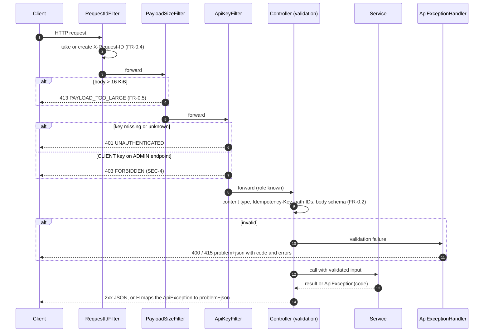
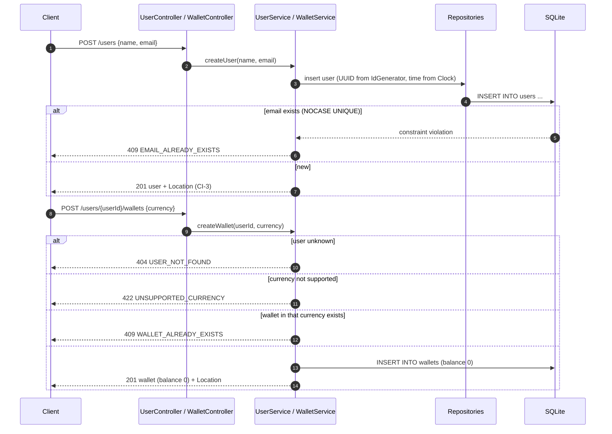
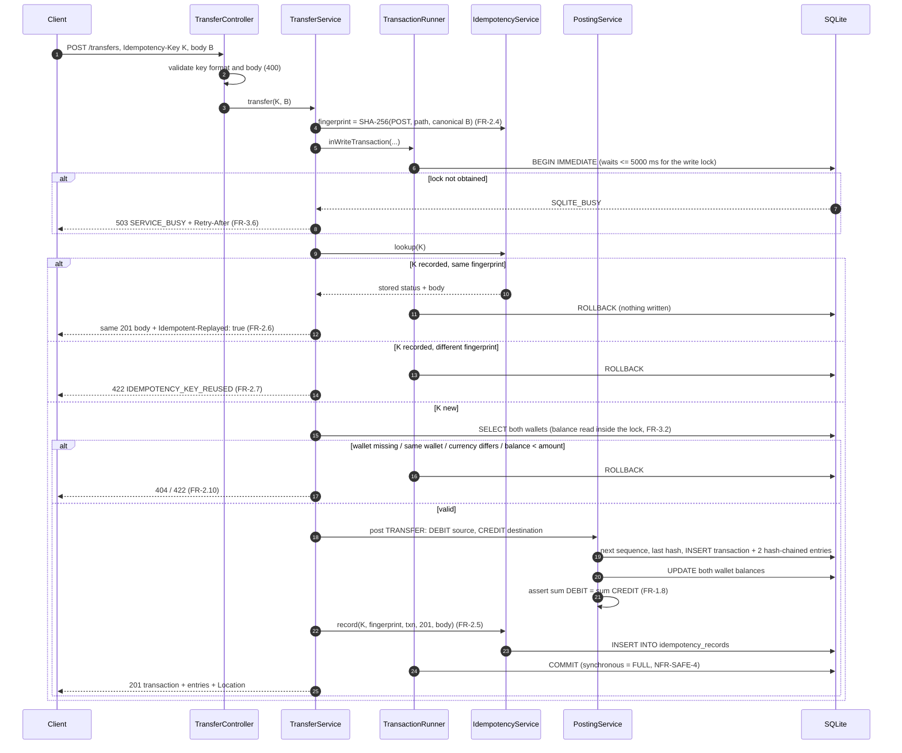
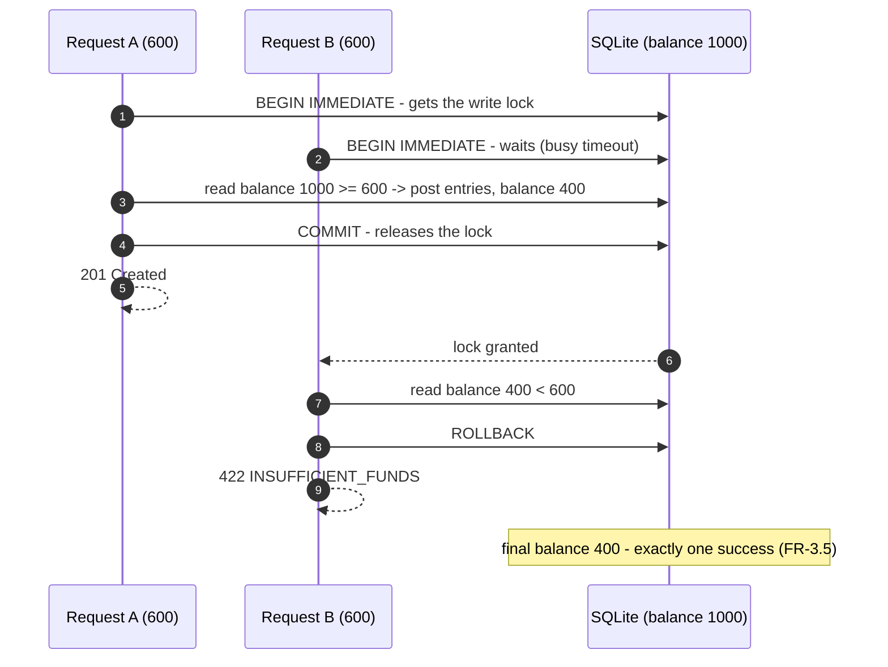
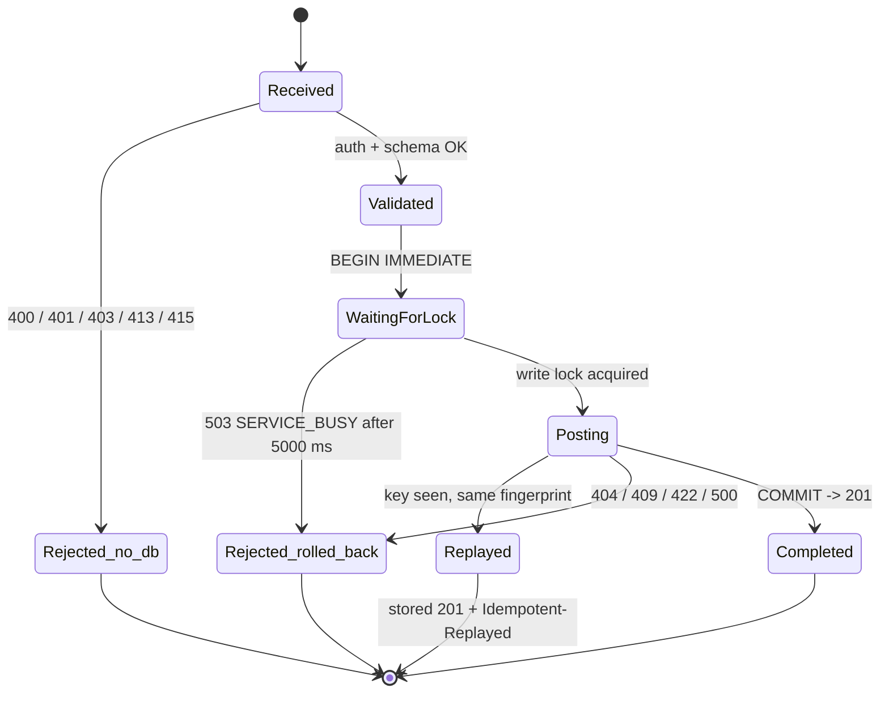
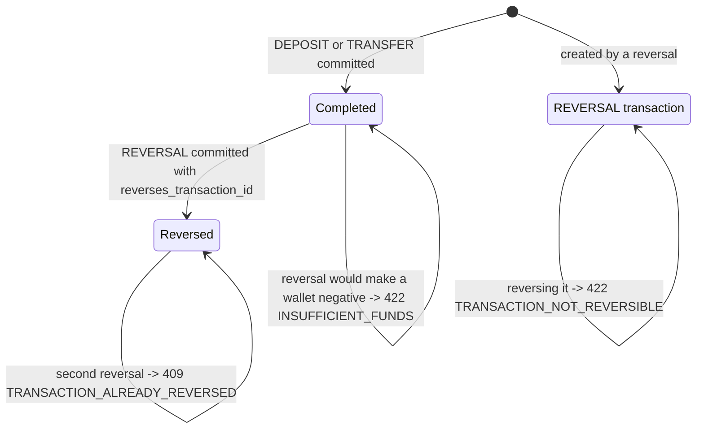
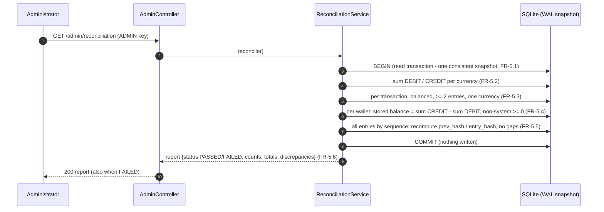
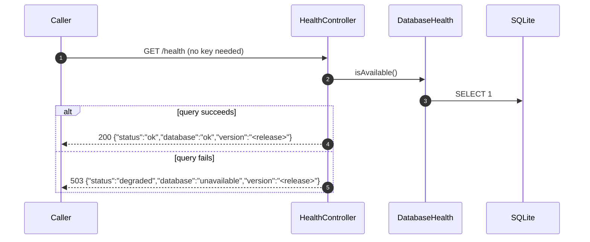

# Behaviour

UML sequence and state diagrams for every feature of SRS section 4 (SE-2). They refine SRS Figures 3 and 4 into the components of [architecture.md](architecture.md); transaction rules come from [ADR-0002](../adr/0002-transactions-concurrency-idempotency.md), integrity rules from [ADR-0003](../adr/0003-ledger-integrity-hash-chain.md), error handling from [ADR-0004](../adr/0004-http-error-model.md).

## 1. Request pipeline (FR-0)

Every request passes the same checks in a fixed order; the first failing check decides the error (SRS 4.7.2).

## 2. Create user and wallet (FR-1.1-FR-1.4)

## 3. Idempotent, concurrency-safe transfer (FR-2, FR-3)

Deposits (FR-1.6) and reversals (FR-4.5) use the same unit of work with different entries.

## 4. Two concurrent transfers from one wallet (FR-3.4, FR-3.5)

The write lock turns simultaneous requests into a serial order; the second sees the first one's committed balance.

## 5. Life cycle of a money-moving request (FR-2, FR-3, FR-4)

## 6. Life cycle of a ledger transaction (FR-4.5-FR-4.7)

The original row never changes; "reversed" is derived from the reversal that points at it (ADR-0003).

## 7. Ledger reconciliation (FR-5)

## 8. Queries and health (FR-6)

Other reads (`GET` user, wallet, entries, transaction) run in a read transaction, see only committed data (FR-6.5), return 400 for a malformed ID and 404 when not found; the entries list is ordered by `sequence` and paginated with `limit` (1-100, default 50) and `offset` (>= 0) plus the total count (FR-6.2).
