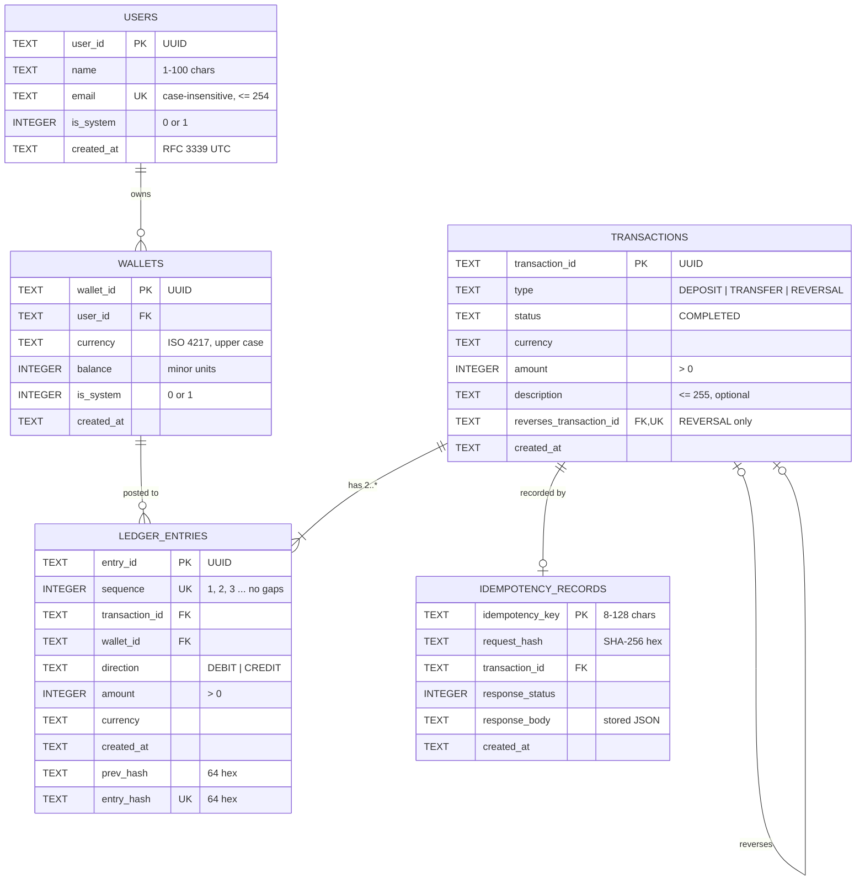

# Data model

Logical and physical data model for SQLite (SRS DR-1-DR-8, SE-2). It refines SRS Figure 2. The schema below is the content of the Stage 3 migration `V1__schema.sql` (SI-4); [ADR-0002](../adr/0002-transactions-concurrency-idempotency.md) and [ADR-0003](../adr/0003-ledger-integrity-hash-chain.md) explain the transaction and integrity rules it supports.

## 1. Entity-relationship diagram (DR-1)



Invariants checked by reconciliation (FR-5): per transaction and overall, sum of DEBIT = sum of CREDIT; `wallets.balance` = sum CREDIT - sum DEBIT of its entries; non-system balances >= 0; the hash chain verifies with no sequence gaps.

## 2. Schema (SQLite DDL)

```sql
-- V1__schema.sql - Financial Ledger & Digital Wallet API (DR-1..DR-7, FR-4.2)

CREATE TABLE users (
    user_id     TEXT    PRIMARY KEY CHECK (length(user_id) = 36),
    name        TEXT    NOT NULL CHECK (length(name) BETWEEN 1 AND 100),
    email       TEXT    NOT NULL COLLATE NOCASE UNIQUE CHECK (length(email) <= 254),
    is_system   INTEGER NOT NULL DEFAULT 0 CHECK (is_system IN (0, 1)),
    created_at  TEXT    NOT NULL
);

CREATE TABLE wallets (
    wallet_id   TEXT    PRIMARY KEY CHECK (length(wallet_id) = 36),
    user_id     TEXT    NOT NULL REFERENCES users (user_id),
    currency    TEXT    NOT NULL CHECK (length(currency) = 3 AND currency = upper(currency)),
    balance     INTEGER NOT NULL DEFAULT 0
                CHECK (balance BETWEEN -9007199254740991 AND 9007199254740991),
    is_system   INTEGER NOT NULL DEFAULT 0 CHECK (is_system IN (0, 1)),
    created_at  TEXT    NOT NULL,
    UNIQUE (user_id, currency),
    CHECK (is_system = 1 OR balance >= 0)
);

CREATE TABLE transactions (
    transaction_id          TEXT    PRIMARY KEY CHECK (length(transaction_id) = 36),
    type                    TEXT    NOT NULL CHECK (type IN ('DEPOSIT', 'TRANSFER', 'REVERSAL')),
    status                  TEXT    NOT NULL DEFAULT 'COMPLETED' CHECK (status = 'COMPLETED'),
    currency                TEXT    NOT NULL CHECK (length(currency) = 3),
    amount                  INTEGER NOT NULL CHECK (amount > 0 AND amount <= 9007199254740991),
    description             TEXT    CHECK (description IS NULL OR length(description) <= 255),
    reverses_transaction_id TEXT    UNIQUE REFERENCES transactions (transaction_id),
    created_at              TEXT    NOT NULL,
    CHECK ((type = 'REVERSAL') = (reverses_transaction_id IS NOT NULL))
);

CREATE TABLE ledger_entries (
    entry_id        TEXT    PRIMARY KEY CHECK (length(entry_id) = 36),
    sequence        INTEGER NOT NULL UNIQUE CHECK (sequence >= 1),
    transaction_id  TEXT    NOT NULL REFERENCES transactions (transaction_id),
    wallet_id       TEXT    NOT NULL REFERENCES wallets (wallet_id),
    direction       TEXT    NOT NULL CHECK (direction IN ('DEBIT', 'CREDIT')),
    amount          INTEGER NOT NULL CHECK (amount > 0 AND amount <= 9007199254740991),
    currency        TEXT    NOT NULL CHECK (length(currency) = 3),
    created_at      TEXT    NOT NULL,
    prev_hash       TEXT    NOT NULL CHECK (length(prev_hash) = 64),
    entry_hash      TEXT    NOT NULL UNIQUE CHECK (length(entry_hash) = 64)
);

CREATE INDEX ix_ledger_entries_wallet      ON ledger_entries (wallet_id, sequence);
CREATE INDEX ix_ledger_entries_transaction ON ledger_entries (transaction_id);

CREATE TABLE idempotency_records (
    idempotency_key TEXT    PRIMARY KEY CHECK (length(idempotency_key) BETWEEN 8 AND 128),
    request_hash    TEXT    NOT NULL CHECK (length(request_hash) = 64),
    transaction_id  TEXT    NOT NULL REFERENCES transactions (transaction_id),
    response_status INTEGER NOT NULL,
    response_body   TEXT    NOT NULL,
    created_at      TEXT    NOT NULL
);

-- Append-only ledger (FR-4.2, DR-4, BR-4)
CREATE TRIGGER trg_transactions_no_update BEFORE UPDATE ON transactions
BEGIN SELECT RAISE(ABORT, 'transactions is append-only'); END;
CREATE TRIGGER trg_transactions_no_delete BEFORE DELETE ON transactions
BEGIN SELECT RAISE(ABORT, 'transactions is append-only'); END;
CREATE TRIGGER trg_ledger_entries_no_update BEFORE UPDATE ON ledger_entries
BEGIN SELECT RAISE(ABORT, 'ledger_entries is append-only'); END;
CREATE TRIGGER trg_ledger_entries_no_delete BEFORE DELETE ON ledger_entries
BEGIN SELECT RAISE(ABORT, 'ledger_entries is append-only'); END;

-- Applied migrations (SI-4)
CREATE TABLE schema_version (
    version     INTEGER PRIMARY KEY,
    description TEXT    NOT NULL,
    applied_at  TEXT    NOT NULL
);
```

The schema was executed against SQLite 3 during design review: all tables, indexes and triggers are created, and an `UPDATE` or `DELETE` on `transactions` or `ledger_entries` is aborted with the trigger message.

## 3. Rules the schema enforces

| Rule | How | Requirement |
|---|---|---|
| Money is an integer of minor units | `INTEGER` columns; Java `long` | DR-2, CON-3 |
| Amounts > 0; at most 2^53 - 1 | `CHECK (amount > 0 AND amount <= 9007199254740991)` | DR-2, NFR-REL-6, BR-8 |
| Non-system wallets never negative | `CHECK (is_system = 1 OR balance >= 0)` | DR-2, NFR-SAFE-2, BR-3 |
| One wallet per user per currency | `UNIQUE (user_id, currency)` | DR-3, FR-1.4, BR-6 |
| Email unique, case-insensitive | `email ... COLLATE NOCASE UNIQUE` | DR-3, FR-1.2 |
| Sequence unique, gap-free | `UNIQUE (sequence)`; assigned as `MAX + 1` inside the serialised write transaction | DR-3, FR-4.3, FR-5.5 |
| Idempotency key unique across endpoints | `idempotency_key` primary key | DR-3, FR-2.9 |
| A transaction reversed at most once | `reverses_transaction_id UNIQUE` | DR-3, FR-4.6, BR-7 |
| Only reversals reference another transaction | `CHECK ((type = 'REVERSAL') = (reverses_transaction_id IS NOT NULL))` | FR-4.5 |
| Ledger append-only | four `RAISE(ABORT)` triggers | FR-4.2, DR-4 |
| Referential integrity | `REFERENCES` + `PRAGMA foreign_keys = ON` per connection | DR-3, SI-2 |
| Timestamps and IDs as text | RFC 3339 UTC strings; canonical lowercase UUIDs (36 chars) | DR-5 |
| Database location configurable | `LEDGER_DB_PATH`; tests use a fresh file | DR-6, TQ-5 |
| Data kept forever | no purge job, no delete on ledger tables | DR-7 |

Rules that need more than one row - balanced transactions (FR-1.8, BR-1), same-currency transfers (BR-2), sufficient funds under concurrency (FR-3) - are enforced in the service layer inside the write transaction (ADR-0002) and verified by reconciliation (FR-5).

## 4. System funding accounts (FR-1.5)

At start-up, for each supported currency, the service ensures exactly one system user (`is_system = 1`, fixed email `system+<currency>@ledger.invalid`) owning one system wallet (`is_system = 1`). Deposits debit this wallet and credit the target wallet (FR-1.6); system wallets are the only ones allowed below zero and are never returned or accepted by CLIENT endpoints.

## 5. Brain notes (DR-8)

The `brain/` vault is not part of the database; its note schema (DR-8) is enforced by `scripts/ci/validate_brain.py` and described in the vault note `second-brain-workflow`.
